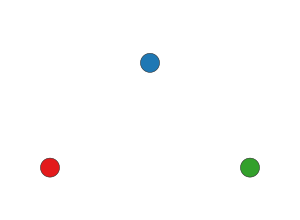
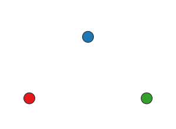
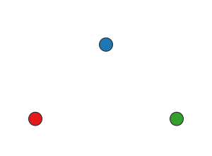
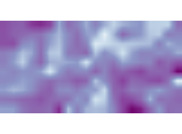
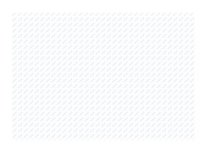
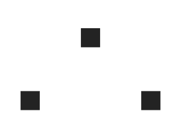
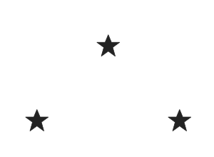
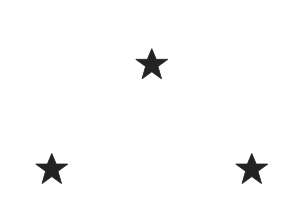

# QGIS to GeoServer: converter options

Three ways to turn a QGIS style into GeoServer SLD. The skill can offer them as a choice (a `CONVERTER` toggle in the export step).

## The three

1. **QGIS native** - `layer.exportSldStyleV3()` (QGIS 3.44+) or `saveSldStyle()`. Built into QGIS, no dependency. Outputs SLD 1.1 (`SvgParameter`). The base the other option builds on.
2. **Ours (default)** - the best-of-both pipeline: use GeoCat Bridge's converter when the plugin is installed (it gets hatches and SVG resources right), otherwise QGIS native, then always run `fix-sld-functions.py` on the result (function-name renames for both QGIS and Bridge names, font reconciliation, SVG / hatch / size detection). Picks the stronger converter per environment and fixes what it misses; no mandatory dependency.
3. **GeoCat Bridge** - the `bridgestyle` library (QGIS to GeoStyler to SLD), bundled in the Bridge QGIS plugin (`geocatbridge.libs.bridgestyle.qgis.layerStyleAsSld`). Outputs SLD 1.0 (`CssParameter`) and returns the icon resources to upload. Bridge is also an end-to-end publisher (uploads SVGs, creates layers), not a converter only.

## Head-to-head (verified)

Run on the `testdata/` fixture against GeoServer 3.0.1 with GeoCat Bridge installed. "Parse" is the upload HTTP status (201 ok, 500 rejected).

| Case | QGIS native | Ours | GeoCat Bridge |
| --- | --- | --- | --- |
| Categorized / polygon | 201 | 201 | 201 |
| Scale / zoom rules | works | works | works |
| Label function `upper()` | `upper` -> 500 | `strToUpperCase` -> 201 | `strToUpper` -> 500 |
| Font (`Ubuntu Sans`/`Sans`) | keeps name | reconciles vs `/rest/fonts`, fallback | keeps name |
| Hatch fill | `horline` -> blank | flags, rewrite `shape://` | `shape://slash` -> renders |
| SVG marker/fill | local href -> square | local href, flagged | returns the icon to upload, bare href |
| Data-defined / expression size | dropped (static) | dropped (re-inject documented) | dropped (warns) |
| Gradient fill | dropped (warns) | dropped | dropped (warns) |
| SLD version / upload type | 1.1, `se+xml` | 1.1, `se+xml` | 1.0, `sld+xml` |
| Publish + upload resources | manual | manual | end to end |

Nobody wins outright:

- **Ours** is the only one that gets function names right (`strToUpperCase`); Bridge's `strToUpper` is just as broken as QGIS's `upper`. Ours is also the only one that reconciles fonts.
- **Bridge** gets the hatch right (`shape://slash`, which native and ours have to patch), and it collects SVG/icon resources and uploads them, which is real value for icon-heavy styles.
- **All three** drop data-defined/expression size and gradient fill: those are QGIS-export limits, not converter-specific.

## Rendered comparison (all three converters)

Each row is the same layer and data rendered by GeoServer from each converter's SLD. `ours` uses Bridge's converter (Bridge is installed here) plus `fix-sld-functions.py`.

Categorized renderer (all three agree):

| QGIS native | Ours | GeoCat Bridge |
| --- | --- | --- |
|  |  |  |

Raster singleband pseudocolor (all three agree, SLD 1.0):

| QGIS native | Ours | GeoCat Bridge |
| --- | --- | --- |
|  |  |  |

Hatch fill (native blank; ours and Bridge render `shape://slash`):

| QGIS native | Ours | GeoCat Bridge |
| --- | --- | --- |
|  |  |  |

SVG marker (native square; ours and Bridge resolve the icon):

| QGIS native | Ours | GeoCat Bridge |
| --- | --- | --- |
|  |  |  |

Function label `upper()` is not shown as images: native (`upper`) and Bridge (`strToUpper`) both produce a style GeoServer rejects (HTTP 500, nothing renders), while ours renames to `strToUpperCase` and renders. Same for fonts. These are the cases where ours beats both others; see the scorecard above.

## Effort

| | Install | Integrate in the skill |
| --- | --- | --- |
| QGIS native | built in | zero (already the base) |
| Ours | built in (one script) | done |
| GeoCat Bridge | the Bridge plugin (installed here) | low: `from geocatbridge.libs.bridgestyle import qgis as bs; sld, icons, warnings = bs.layerStyleAsSld(layer)`, then upload the `icons` and the SLD as `sld+xml` |

A `CONVERTER = "qgis" | "ours" | "bridge"` switch in the export step is ~20-30 lines. Upload and compare steps do not change, except Bridge needs the `sld+xml` content type and uploads its `icons`.

## Recommendation

**Ours is the default, and it is the best:** it uses Bridge's converter when the plugin is installed (correct hatches, SVG/icon upload) and QGIS native otherwise, then always runs `fix-sld-functions.py`, which gets the function names and fonts right for either converter (it maps both QGIS `upper` and Bridge `strToUpper` to `strToUpperCase`). So you get Bridge's strengths plus our fixes, and it still works with no Bridge installed. Pick plain `qgis` or `bridge` only to see a single converter's raw output. All paths still need the data-defined-size re-injection and the SVG `linearGradient` GraphicFill for gradients; those are QGIS-export limits, not converter-specific.
- All three still need the data-defined-size re-injection and a gradient workaround (SVG `linearGradient` GraphicFill); those are not converter-specific.
