# QGIS to GeoServer: styling comparison

What a QGIS style looks like after it reaches GeoServer, and how the three
converters compare. Each row is the same layer and data, rendered four ways:

- **QGIS**: the source style, rendered in QGIS.
- **native**: QGIS's own SLD export (`exportSldStyleV3` for vectors, `saveSldStyle` for rasters).
- **bridge**: the GeoCat Bridge converter (`bridgestyle`, SLD 1.0, uploads icon resources).
- **ours**: Bridge's converter when the plugin is installed, else native, then always `fix-sld-functions.py` (function renames, font reconcile, font-marker and line-label and point-label fixes, SVG/hatch flags). The skill default.

## Scorecard

Rows are in the same order as the sections below.

| Style | native | bridge | ours |
| --- | --- | --- | --- |
| Font marker + `upper()` label | error | error | glyph + labels |
| Field-driven size + rotation | size dropped | ok | ok |
| Curved line labels | straight, 2 of 3, serif | straight, 2 of 3, serif | follows bends, all 3, sans |
| Categorized points + labels | label on the marker, serif | label on the marker, serif | label offset, sans |
| Polygon + label | ok¹ | ok¹ | ok |
| Rotation arrows | ok | ok | ok |
| Raster pseudocolor (speed) | ok | ok | ok |
| Raster pseudocolor (pressure) | ok | ok | ok |
| Graduated line (flow) | ok | ok | ok |

¹ The label font (`Open Sans`) falls back to serif on GeoServer; `ours` reconciles
it to the sans fallback. The polygon itself is identical.

## Where the converters differ

### Font marker + `upper()` label

native emits `upper`, Bridge emits `strToUpper`; GeoServer rejects both and draws
the parse error instead of the map. `ours` rewrites to `strToUpperCase`, reconciles
the label font, renders the font-marker glyph (a `ttf://` mark needs a real font,
not the logical `SansSerif`), and offsets the label off the marker.

| QGIS | native | bridge | ours |
| --- | --- | --- | --- |
| 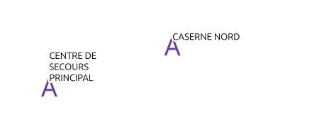 |  | 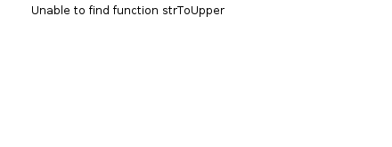 | 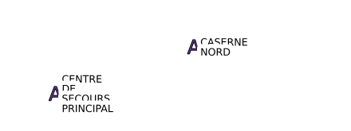 |

### Field-driven size + rotation

native collapses the data-defined size to a small static marker; Bridge and ours
keep the per-feature size and rotation.

| QGIS | native | bridge | ours |
| --- | --- | --- | --- |
| 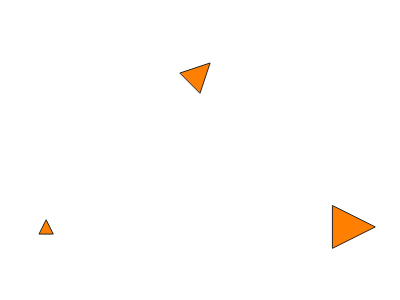 | 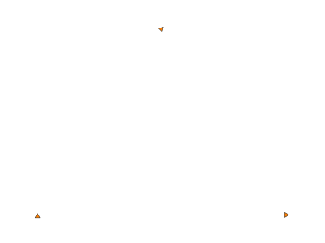 |  | 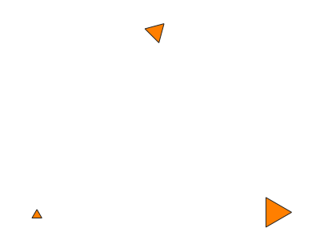 |

### Curved line labels

`ours` lifts the labels off the line, follows the bends, and keeps all three in a
sans font (`fix-sld-functions.py` raises `maxAngleDelta` and adds the offset,
repeat and group vendor options). native and Bridge keep two, straight and on the
line, in a serif fallback.

| QGIS | native | bridge | ours |
| --- | --- | --- | --- |
| 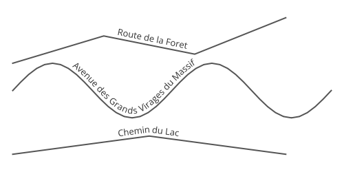 | 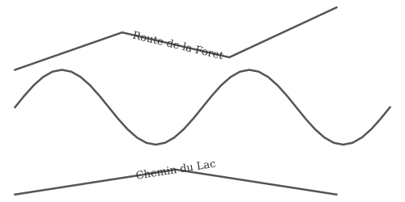 |  | 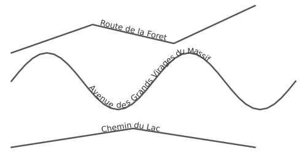 |

### Categorized points + labels

The dots match everywhere. native and Bridge sit the label on top of the dot in a
serif fallback; `ours` offsets it off the marker and reconciles the font to sans.

| QGIS | native | bridge | ours |
| --- | --- | --- | --- |
| 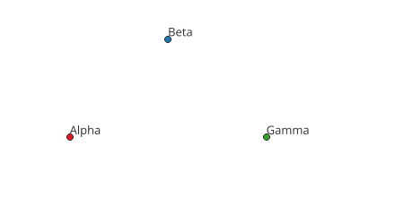 |  |  |  |

## Where they agree

### Polygon + label

| QGIS | native | bridge | ours |
| --- | --- | --- | --- |
| 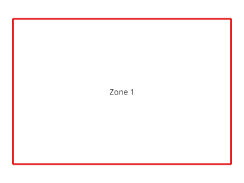 | 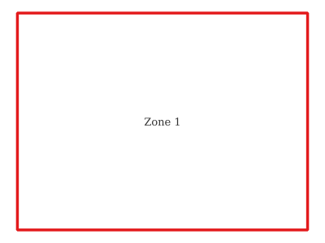 |  |  |

### Rotation arrows

| QGIS | native | bridge | ours |
| --- | --- | --- | --- |
| 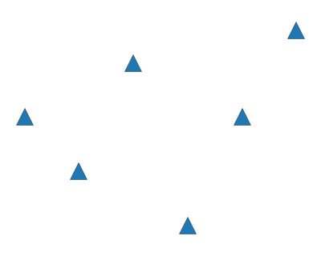 |  |  | 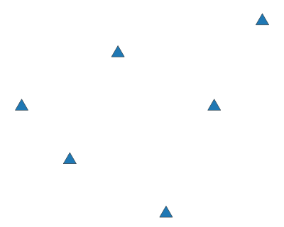 |

### Raster pseudocolor: wind speed

Rendered with bilinear interpolation, as QGIS does; GeoServer defaults to
nearest-neighbour (set it on the coverage, see SKILL.md).

| QGIS | native | bridge | ours |
| --- | --- | --- | --- |
| 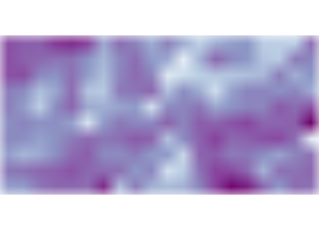 |  |  |  |

### Raster pseudocolor: pressure

| QGIS | native | bridge | ours |
| --- | --- | --- | --- |
| 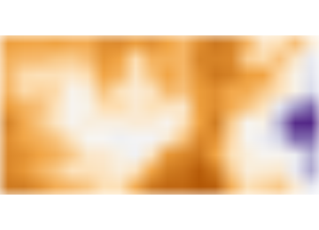 |  | 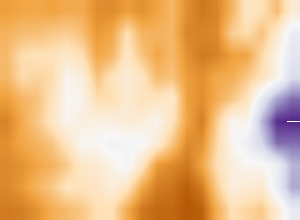 |  |

### Graduated line: flow

| QGIS | native | bridge | ours |
| --- | --- | --- | --- |
| 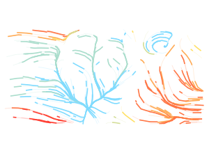 | 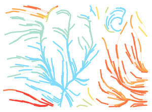 | 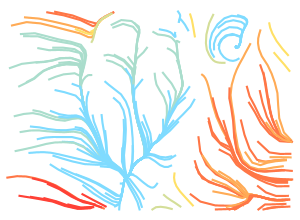 |  |

## Choosing a converter

`ours` is the default. Pick plain `native` or `bridge` only to inspect a single
converter's raw output; see `skills/qgis-to-geoserver/SKILL.md` for the toggle.
Limits shared by all three (QGIS-export, not converter-specific): gradient fills
drop (use an SVG `linearGradient` GraphicFill).

## Reproduce

Fixtures and styles live in `skills/qgis-to-geoserver/testdata`: `style_tests.qgz`
and `sld/` for the vectors, `wind/` for the rasters and flow. Checked on QGIS
4.2.3, GeoServer 3.0.1, and GeoCat Bridge 4.6.1 (bridgestyle 0.1.8). QGIS panels
at 90.7 DPI; GeoServer panels via WMS GetMap at the same bbox (rasters with
`interpolations=bilinear`). Export each style three ways, upload, and render; see
`SKILL.md` for the steps and `fix-sld-functions.py --check` for what `ours`
rewrites.
