# QGIS styling vs GeoServer SLD

What survives the QGIS to GeoServer SLD conversion, what degrades, and the fix. Every row below was checked by rendering the SAME layer in QGIS and in GeoServer and comparing the images, not just by parsing the SLD. Verified on GeoServer 3.0.1 (GeoTools 35.1) and QGIS 4.2.3 (`exportSldStyleV3`) with the fixture in `skills/qgis-to-geoserver/testdata/` (`fixtures.gpkg` published to GeoServer, SLDs from `style_tests.qgz`). "Parse" is the HTTP status when the SLD is uploaded as a style (201 parsed, 500 rejected); "render" is whether the GetMap image matches QGIS.

## Summary

The symbology path mostly holds; the breakage is in labels, expressions, data-defined size, and anything that depends on a resource (font, SVG) the GeoServer container does not have.

| QGIS technique | Parse | Render vs QGIS | Status | Fix |
| --- | --- | --- | --- | --- |
| Single symbol, categorized renderer | 201 | matches (minor marker-size and label-offset diffs) | works | - |
| Rule-based renderer with filters | 201 | matches | works | - |
| Graduated renderer (real data: wind flow, 7 classes) | 201 | matches, same color ramp | works | - |
| Polygon fill and outline + label | 201 | matches | works | - |
| Simple field label | 201 | matches | works | - |
| Data-defined rotation | 201 | matches (orientations vary) | works | - |
| Data-defined size | 201 | dropped: QGIS exports a static `Size`, so GeoServer draws every marker the same; re-injecting the expression restores it | degrades then fixable | re-inject `Size` as `field * 3.78` (mm to px) |
| Expression label with a string function | 500 | n/a | breaks | `fix-sld-functions.py` (rename or rework) |
| Font marker | 201 | render fails: `Unknown font <name>` when the font is not in the container | breaks at render | install the font in GeoServer (Cloud 3.0.2: `/opt/additional_fonts`) |
| Label on Postgres `text[]`, one value | 201 | matches | works | - |
| Label on Postgres `text[]`, many values | 201 | `[Ljava.lang.String@...]` | breaks (visual) | join to a scalar before labelling |
| SVG marker from a local QGIS path | varies | href GeoServer cannot resolve, draws a square | breaks | upload the SVG, rewrite href to the bare name |
| Rule-based renderer with ELSE | 201 | matches | works | - |
| Dashed line (custom dash) | 201 | matches | works | - |
| Marker line (markers along a line) | 201 | `GraphicStroke`, matches | works | - |
| Multiline label (`char(10)`) | 201 | real newline via `Concatenate`, matches | works | - |
| Marker rotated by a field (wind arrows) | 201 | orientations match | works | - |
| Curved label along a line | 201 | follows the line; GeoServer centers it on the line, QGIS offsets above | works | - |
| Data-defined color (`ramp_color`, expression fill) | 201 | NOT dynamic: exported as one static color | degrades | rebuild as an SLD `Interpolate`/`Recode` by hand, or accept static |
| Time-dependent expression (`now()`, `format_date(now())`) | 201 | frozen to the export-date literal, never re-evaluated | degrades | compute server-side or avoid time in the label |
| Raster singleband pseudocolor | 500 as SLD 1.1, 201 as SLD 1.0 | matches (via SLD 1.0) | works | export raster as SLD 1.0, not 1.1 |
| Blend modes, layer opacity | - | no SLD equivalent, dropped | not portable | - |

Four of these only show up when you render, never when you parse: data-defined size, data-defined color, a time-dependent expression, and the font marker all upload as 201 and then render wrong, frozen, or failing. Parse-only validation (an upload 201) is not enough; render and compare.

## Rendered comparison

Same fixture layer, left rendered by QGIS, right by GeoServer from the exported SLD.

Categorized renderer plus labels: reproduces (minor marker-size and label-offset differences).

| QGIS | GeoServer |
| --- | --- |
|  | 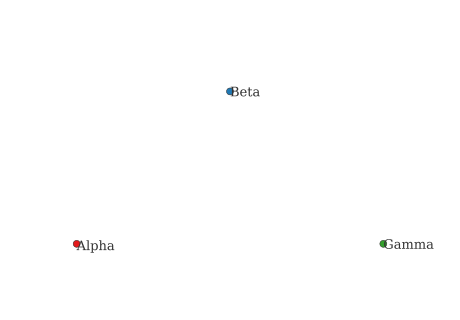 |

Data-defined size and rotation: QGIS varies both. GeoServer keeps the rotation, but QGIS drops the size on export (static `Size`), so by default every marker is the same; shown here after re-injecting the size expression, which restores the variation to match QGIS.

| QGIS | GeoServer |
| --- | --- |
|  | 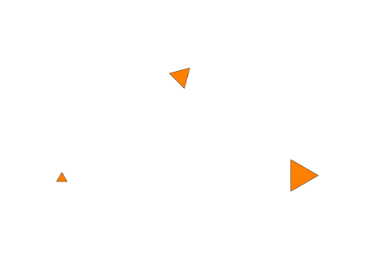 |

Markers rotated by a field (wind arrows): orientations reproduce; markers render a touch smaller.

| QGIS | GeoServer |
| --- | --- |
|  | 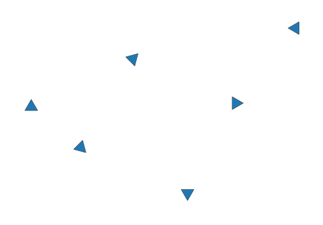 |

Curved label along a line: the text follows the line on both; by default GeoServer centres it on the line while QGIS offsets it above.

As exported, the default looks poor: the label sits on the line and QGIS writes `maxAngleDelta=25`, too low to follow a real bend. Adding the GeoServer line-label vendor options (see the skill) lifts it off the line and follows the curve. Use a NEGATIVE `PerpendicularOffset` so the label sits above the line as in QGIS (positive puts it below). One limitation: `followLine` tracks smooth curvature only; at a sharp polyline vertex GeoServer will not kink the text, it straightens it onto a run or drops it (smooth the geometry if a sharp corner must be labelled).

| QGIS | GeoServer (with line-label vendor options) |
| --- | --- |
|  | 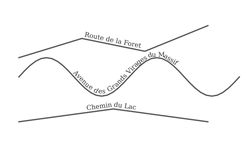 |

Graduated renderer on real data (wind-flow streamlines, 7 speed classes): the classification and color ramp reproduce faithfully.

| QGIS | GeoServer |
| --- | --- |
|  | 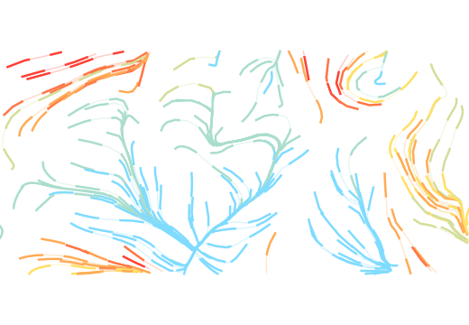 |

## More techniques tested

A second pass covered 16 further techniques (authored in QGIS, exported, uploaded, and rendered). All 16 parse (HTTP 201); the split is again symbology-holds, expressions-and-resources-break.

Works (reproduces):

- Scale/zoom-dependent rules: min/max `ScaleDenominator` is kept, so zoom ranges carry over.
- Categorized renderer with a color ramp (many classes); graduated renderer by size.
- Rule-based renderer combining a filter and a scale range.
- Marker with several stacked symbol layers.
- Polygon fill opacity.
- Dashed line with offset (`stroke-dasharray` + `PerpendicularOffset`).
- Label with a graphic background (shield).
- Multi-field concatenated label.

Degrades (parse 201, render wrong):

- Expression-driven fill color: flattened to one static color (same as a data-defined color).
- Expression-driven size: flattened to a static `Size` (re-inject as an expression, see data-defined size above).
- Gradient fill: QGIS cannot export it. The export warns `Symbol layer GradientFill cannot be converted to SLD` and writes an empty rule (a `Name` with no symbolizer), so GeoServer has nothing to draw and the polygon is blank. SLD has no gradient fill, but an SVG `linearGradient` referenced as a `GraphicFill` approximates one. It tiles from the map origin, so a faint seam can appear and a true per-feature gradient is not achievable; otherwise use a solid colour or a hatch.
- SVG marker and SVG fill: the href is the local QGIS path, so GeoServer draws a square; upload the SVG and rewrite the href to the bare filename.
- Hatch / line-pattern fill: QGIS exports `<se:WellKnownName>horline</se:WellKnownName>`, which GeoServer does not know, so the polygon renders blank. Rewrite it to GeoServer's hatch syntax `shape://horline` (or `shape://slash`, etc.) and it renders.
- Marker / arrow line: the geometry follows, but the marker spacing differs: QGIS spaces the markers apart, GeoServer packs them dense. Set the `GraphicStroke` graphic size and gap to match the QGIS interval.

### Rendered samples

SVG marker: by default GeoServer draws a square (the href is the local QGIS path). The GeoServer image below is after uploading the SVG and using the bare href, which matches QGIS.

| QGIS | GeoServer |
| --- | --- |
| 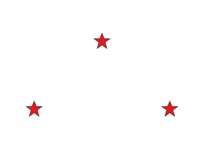 | 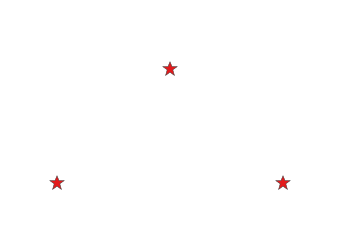 |

Gradient fill: QGIS cannot export it, so GeoServer renders nothing by default. The GeoServer image below uses the SVG `linearGradient` GraphicFill workaround (faint seam from tiling).

| QGIS | GeoServer |
| --- | --- |
| 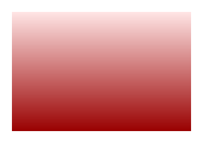 | 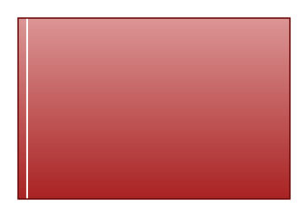 |

Hatch fill: blank on GeoServer as exported (`horline`); rewritten to `shape://slash` it matches the QGIS diagonal hatch.

| QGIS | GeoServer |
| --- | --- |
| 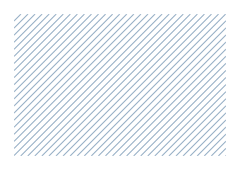 | 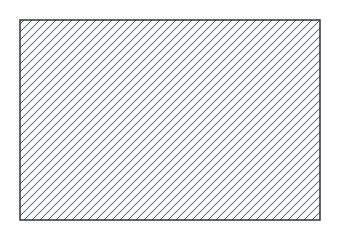 |

Marker line: geometry follows, but the marker spacing differs (QGIS spaces them, GeoServer packs them dense).

| QGIS | GeoServer |
| --- | --- |
| 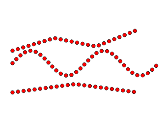 | 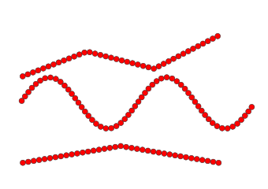 |

## Complex examples

### Expression label: function names do not match

QGIS exports the expression tree with its own function names; GeoTools uses different ones, and one unknown function makes GeoServer reject the whole style.

QGIS `upper("nom")` exports `<ogc:Function name="upper">...`, which GeoServer rejects: `HTTP 500, Unable to find function upper`. After `fix-sld-functions.py` rewrites it to `strToUpperCase`: `HTTP 201`.

Safe 1:1 renames the script applies: `upper`, `lower`, `trim`, `length`, `concat`, `title`. Functions whose GeoTools form differs in arguments or arity, which the script refuses so they get reworked in QGIS: `substr`, `replace`, `coalesce`, `round`, `strpos`, `left`, `right`, `to_string`, `format_number`.

### Data-defined size renders uniform

`ddl_pts` carries a triangle with data-defined size (`sz` = 4, 8, 12) and rotation (`ang` = 0, 45, 90). In QGIS the three triangles are clearly small, medium, large and rotated. QGIS exports the rotation as an expression but drops the size: the SLD carries a static `<se:Size>7</se:Size>`, so GeoServer draws all three the same. Re-inject the size as an expression, `<se:Size><ogc:Mul><ogc:PropertyName>sz</ogc:PropertyName><ogc:Literal>3.78</ogc:Literal></ogc:Mul></se:Size>` (3.78 = mm to px at 96 DPI), and the variation returns and matches QGIS, as shown above.

### Font marker needs the font in GeoServer

`label_pts` uses a font marker. The SLD parses (201), but the GetMap fails with `Rendering process failed ... Unknown font Sans`: GeoServer renders fonts from the fonts installed in its own JVM/container, not from the author's machine. Install the font in the GeoServer image, or on GeoServer Cloud 3.0.2 mount it at `/opt/additional_fonts`.

### Array column label

A Postgres array column labels cleanly only when a feature holds one value; multiple values render as `[Ljava.lang.String@...]`. GeoServer has no `array_to_string`, `item()` or `col[1]` in SLD or CQL. Fix in the data: a generated column `array_to_string(col, ', ')` (needs an IMMUTABLE wrapper, the stock function is only STABLE) or a SQL view, then label that scalar. (GeoPackage has no array type, so this one is PostGIS only and not in the fixture.)

### Raster color map needs SLD 1.0, not 1.1

A singleband pseudocolor raster exported as SLD 1.1 (`exportSldStyleV3`) uses the old `ColorMapEntry` list inside an SE 1.1 document, which GeoServer rejects: `Parsing failed for ColorMap: Categorize or Interpolate not specified`. The same style exported as SLD 1.0 (`saveSldStyle`) uploads 201 and renders identically to QGIS. For rasters, export 1.0; publish the data as a GeoTIFF coverage store.

| QGIS | GeoServer |
| --- | --- |
| 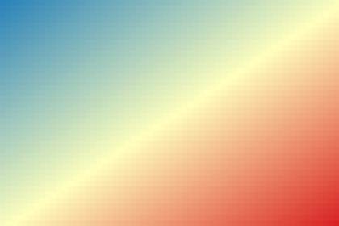 | 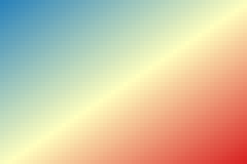 |

### Data-defined color and time are flattened at export

QGIS evaluates some expressions once, at export, instead of emitting a dynamic SLD function:

- A data-defined fill `ramp_color('Viridis', "v"/20)` exports as a single static `fill` color; the per-feature colour is gone. To keep it, hand-write an SLD `Interpolate` or `Recode` on the attribute.
- A label `format_date(now(), 'yyyy-MM-dd')` exports as the literal export date (for example `2026-10-16`), so every render shows that frozen date, not the current one.

Both upload as 201 and look fine in isolation; only a render against real data (or reading the exported SLD) shows the value is static.

## Reproduce

Publish `fixtures.gpkg` to a scratch workspace, upload the SLDs (run `fix-sld-functions.py` first), then GetMap each layer and compare against a QGIS render of the same layer and extent. See `skills/qgis-to-geoserver/SKILL.md` for the full workflow and the one-layer-per-job rendering rule.
